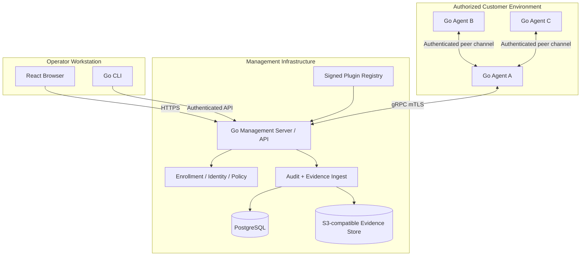
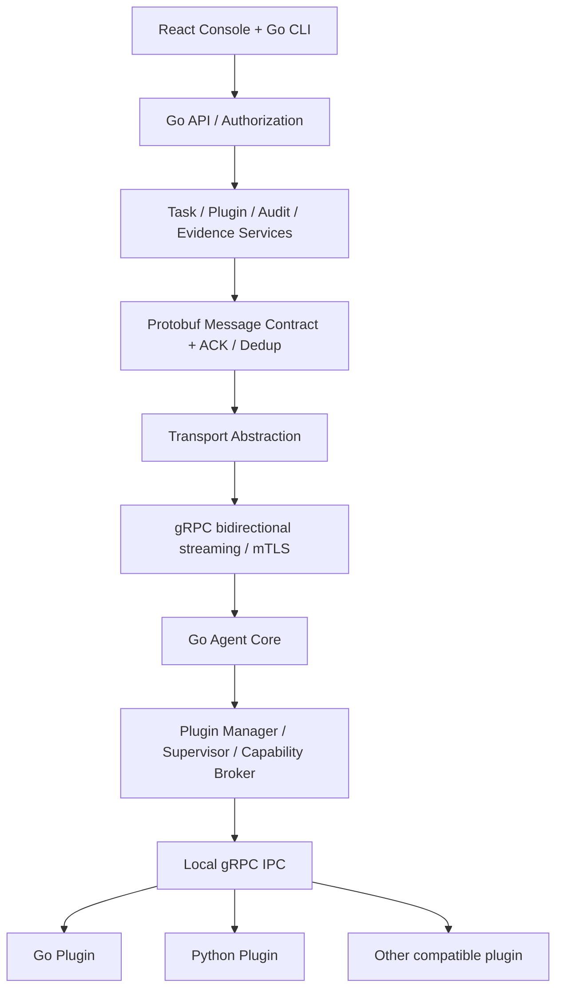
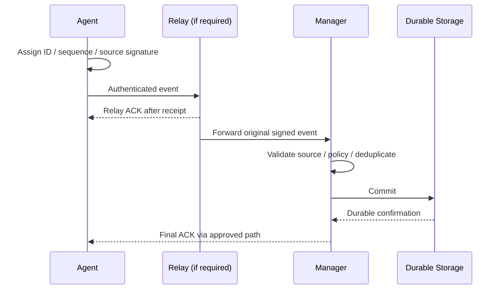

# Architecture and Deployment

## Physical deployment / trust boundaries

All roles run one Agent binary. Leadership and manager-reachability are independent; peer membership is signed by Manager. Diagram shows illustrative connectivity, not unrestricted network reachability.

## Framework layering

## Core boundaries
Agent may persist identity, election safety metadata, installed plugin packages and limited encrypted spool files; it must not host a system-log database. Manager alone durably stores canonical evidence and operational audit. Plugin signing keys stay off endpoints.

## Data flow

Relay ACK never implies durable Manager receipt. During outage, bounded encrypted spool may lose messages on capacity exhaustion and must emit gap alerts. Full TCP session migration is not promised.

## Security controls
Written engagement scopes; per-tenant separation; authenticated operator; authorization before tasks; least-privilege plugin processes; explicit capability grants; immutable audit archives; expiry, cancellation and emergency-stop support.
