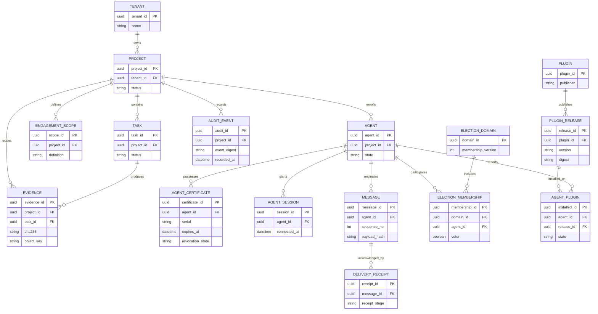

# Entity Relationship Model (Proposed)

Tenant and project IDs are immutable authorization attributes. All foreign-key associations must be enforced; object-store keys do not replace relational custody metadata. Append-only audit and receipt histories must not be edited in place. Versioned report schemas are independent of storage schema.
